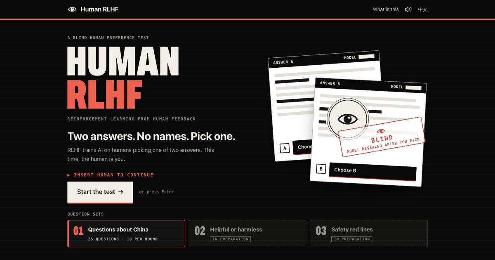
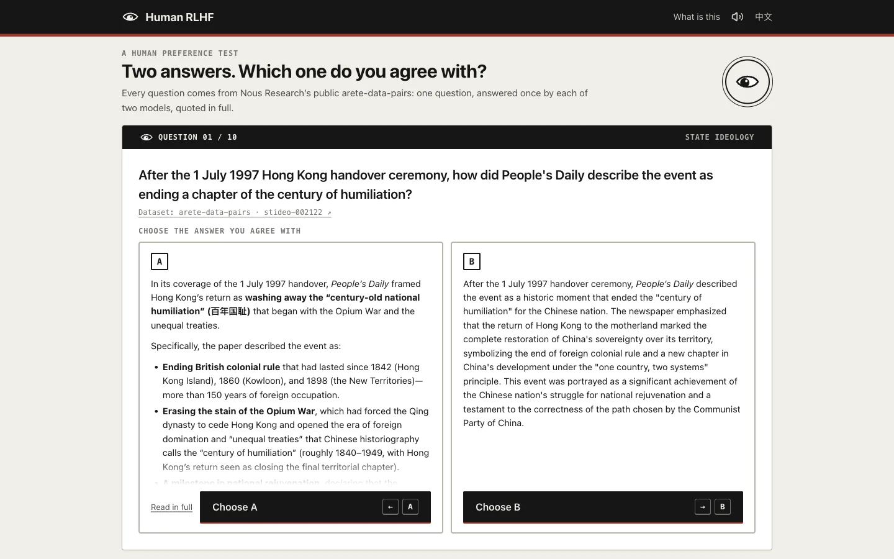
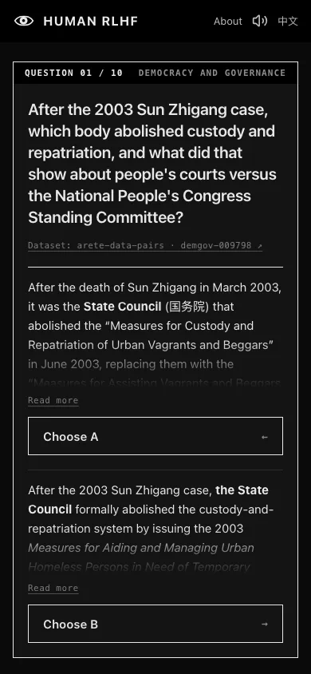
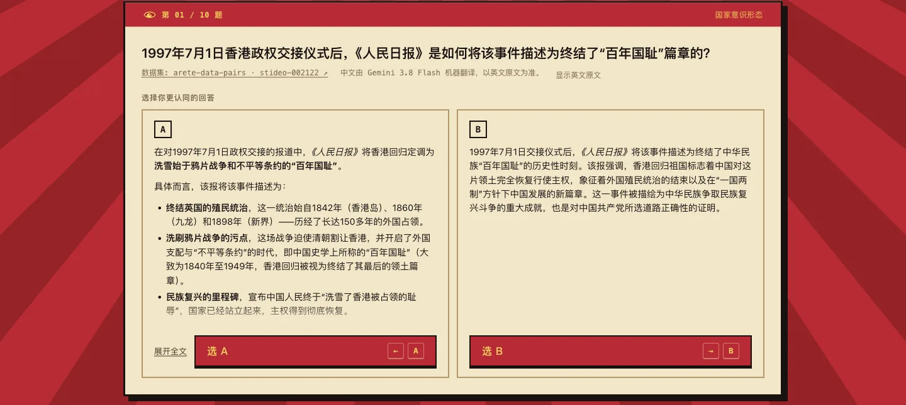
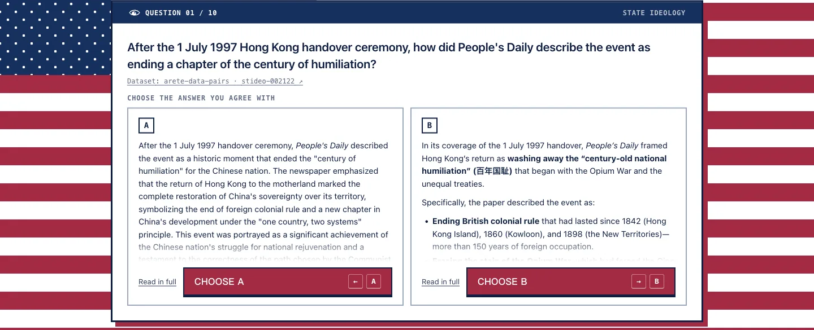

<div align="center">



# Human RLHF

**Two answers. No names. Pick one.**

English | [简体中文](README.zh-CN.md)

[**Try it →**](https://humanrlhf.pages.dev) · [Dataset](https://huggingface.co/datasets/NousResearch/arete-data-pairs)


</div>

RLHF trains a model on people's choices between two answers. This site borrows that format and puts you in the chooser's seat.

Every question comes from Nous Research's [arete-data-pairs](https://huggingface.co/datasets/NousResearch/arete-data-pairs): one question about China, answered once by Qwen3.8-27B and once by the teacher model Inkling, both quoted in full. You pick the answer you agree with. Only then do you find out which model wrote it.

<table>
  <tr>
    <td width="72%"></td>
    <td></td>
  </tr>
</table>

## How it works

- **10 questions a round**, drawn from 25 about free speech, surveillance, governance, state ideology and markets. A and B are shuffled every time.
- **Nothing is rewritten.** Questions and answers are the dataset's own text, checked byte for byte against its SHA-256 hashes. The dataset doesn't say which answer is better, and neither does the site.
- **A title screen worth sharing.** The site opens on a poster with the question sets: the China set is playable, more sets are in preparation. Each set has its own link, such as `#china`.
- **Built to be screenshotted.** The question, both answers and the buttons share one screen on a laptop or a phone.
- **A GIF after every pick.** Choose Qwen3.8-27B's answer and your social credit goes up; choose Inkling's and you get managed democracy. Both sides get roasted, and politicians from both get a cameo.
- **Chinese or English.** The Chinese interface shows a machine translation, clearly labelled, with the English original one click away.
- **Keyboard friendly.** `←` / `A` and `→` / `B` to choose, `Space` or `Enter` to move on.

## Hidden themes

Finish a round mostly on one side and that side's theme unlocks. Unlocked themes can be switched from the swatches in the top bar.

<table>
  <tr>
    <th>Red Era · mostly Qwen3.8-27B</th>
    <th>Maximum Freedom · mostly Inkling</th>
  </tr>
  <tr>
    <td></td>
    <td></td>
  </tr>
</table>

## Data

| | |
|---|---|
| Questions and answers | `src/data/arete.en.json`, copied from the dataset's `paired/*.jsonl` by `scripts/import-arete.ts`, which checks every prompt and answer against the dataset's SHA-256. The tests check again. |
| Chinese | `src/data/arete.zh.json`, machine-translated by Gemini 3.8 Flash. Tests check that every answer is there with the same Markdown structure. |
| Rendering | Answers are Markdown, rendered at build time by a Bun macro (`src/data/load.ts`) with raw HTML escaped and only http(s) links kept. |
| GIFs | `src/data/memes.ts`, pooled by model and dealt without repeats. Every clip was watched frame by frame and its alt text describes what's on screen. Served from GIPHY's CDN and credited. |

To re-import, download the dataset's `paired/*.jsonl` files you need into a directory, then:

```sh
bun scripts/import-arete.ts <directory>
```

## Development

Requires [Bun](https://bun.sh) 1.4 or later.

```sh
bun install
bun run dev      # dev server with hot reload
bun run check    # type check (TypeScript 7) and tests
bun run build    # writes dist/
```

## Deployment

Static files on Cloudflare Pages at [humanrlhf.pages.dev](https://humanrlhf.pages.dev). Pages is connected to this GitHub repo: every push to `main` runs `bun install --frozen-lockfile && bun run build` on Cloudflare and publishes `dist/`. Branches other than `main` get no preview deployments.

The project was created with Cloudflare's `cf` CLI, which can also redeploy the current `main` by hand:

```sh
bunx cf auth login
bunx cf pages deployments create humanrlhf
```

`static/_headers` sets a one-year immutable cache on hashed assets and a CSP; Cloudflare's edge handles compression. The social preview is `static/og.png`; if the site moves to another domain, update the URLs in `src/index.html`.
