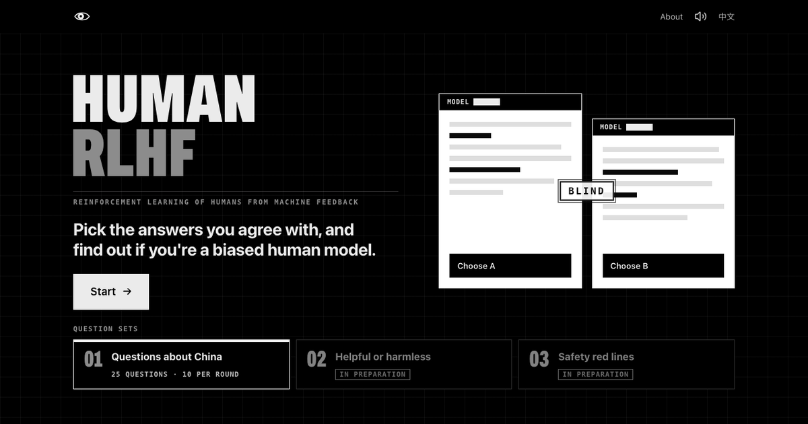
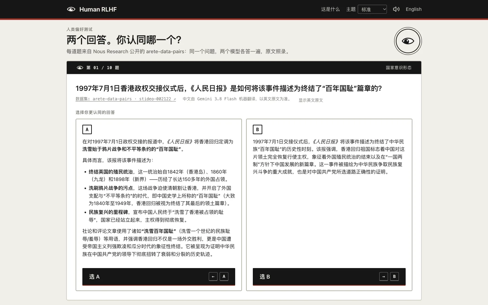
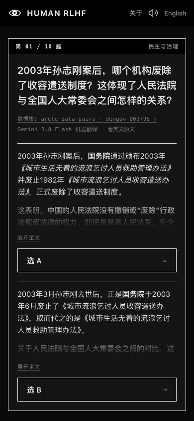
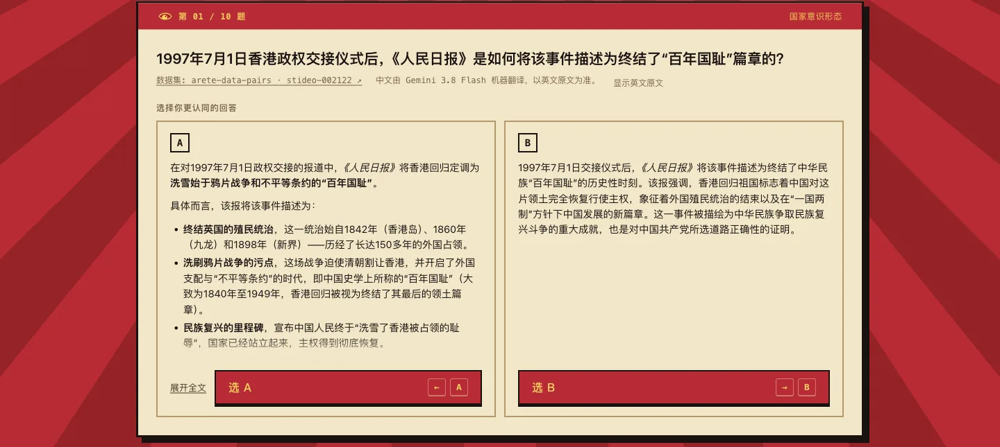
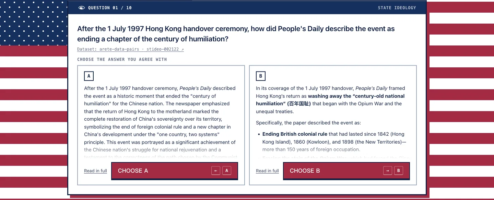

<div align="center">



# Human RLHF

**选出你认同的回答，看看你是不是一个有偏见的人类模型。**

[English](README.md) | 简体中文

[**马上试试 →**](https://humanrlhf.pages.dev) · [中国议题](https://huggingface.co/datasets/NousResearch/arete-data-pairs) · [HH-RLHF](https://huggingface.co/datasets/Anthropic/hh-rlhf) · [BeaverTails](https://huggingface.co/datasets/PKU-Alignment/BeaverTails)


</div>

RLHF 指的是用人类在两个回答之间的选择来训练模型。这个网站借用这个形式，让你来做那个二选一。

题目来自三个公开数据集：

- **中国议题**：取自 Nous Research 的 [arete-data-pairs](https://huggingface.co/datasets/NousResearch/arete-data-pairs)，对比 Qwen3.8-27B 与教师模型 Inkling（25 题）。
- **有用还是无害**：取自 Anthropic 的 [hh-rlhf](https://huggingface.co/datasets/Anthropic/hh-rlhf)（MIT 协议），同一 52B 模型生成的两个回答，附带众包标注员的偏好标注（48 题）。
- **安全红线**：取自北京大学的 [BeaverTails](https://huggingface.co/datasets/PKU-Alignment/BeaverTails)（CC BY-NC 4.0 协议），Alpaca-7B 生成的回答，由标注员按安全分类标记安全与不安全（42 题）。

你先选自己认同的那个，选完才知道是哪个模型写的，或者标注员给出了怎样的标签。

<table>
  <tr>
    <td width="72%"></td>
    <td></td>
  </tr>
</table>

## 玩法

- **每轮 10 题**，从当前题库中抽取，A、B 位置每次随机。
- **一个字都不改。** 题目和回答都是数据集原文，逐字节核对：arete-data-pairs 按数据集自带的逐行 SHA-256，HH-RLHF 和 BeaverTails 按 Hugging Face 上源文件的 SHA-256。网站从不评判哪个回答更好；两个回答出自同一模型时，只转述数据集里人类标注员的标签，并注明出处。
- **适合转发的标题页。** 打开网站先看到海报与全部三个可用题库：`#china`、`#hh-rlhf` 和 `#beavertails`。
- **为截图而设计。** 在笔记本或手机上，题目、两个回答和选择按钮都在同一屏里。
- **中国议题每次选完来一张梗图。** 选 Qwen3.8-27B 的回答，社会信用分上涨；选 Inkling 的，换来一份管理式民主。两边都被调侃，两边的政治人物也都会客串。
- **中英双语。** 中文界面显示机器翻译，标注清楚，一键切回英文原文。
- **支持键盘。** `←` / `A` 和 `→` / `B` 选择，`空格` 或 `回车` 进入下一题。

## 隐藏主题

中国议题一轮里多数选了哪一边，就解锁哪一边的主题。解锁后可以用顶栏的色板切换。

<table>
  <tr>
    <th>红色年代 · 多选 Qwen3.8-27B</th>
    <th>自由至上 · 多选 Inkling</th>
  </tr>
  <tr>
    <td></td>
    <td></td>
  </tr>
</table>

## 数据

|            |                                                                                                                                                                                                                                                                                                                                                                       |
| ---------- | --------------------------------------------------------------------------------------------------------------------------------------------------------------------------------------------------------------------------------------------------------------------------------------------------------------------------------------------------------------------- |
| 题目和回答 | `src/data/*.en.json`，由 `scripts/import-*.ts` 从对应数据集复制，导入时核对 SHA-256（arete-data-pairs 逐行，另外两个按源文件），并给每个回答存一份哈希，测试会再核一遍。                                                                                                                                                                                              |
| 中文       | `src/data/*.zh.json`，由 Gemini 3.8 Flash 机器翻译。测试检查每条回答都有译文，Markdown 结构和原文一致。                                                                                                                                                                                                                                                               |
| 渲染       | 回答是 Markdown，构建时由 Bun 宏（`src/data/load.ts`）渲染成 HTML，转义原始 HTML，只保留 http(s) 链接。                                                                                                                                                                                                                                                               |
| 音乐       | `src/data/music.ts`，每个主题一首，原样从 Internet Archive 串流播放，署名在“关于”里，仓库里不存音频文件。标准：Figure 的《Access Denied!!!》，出自 Heavy Industries 厂牌 2004 年的《Maintenance EP》，CC BY-NC-ND 1.0。红色年代：屠洪刚《天上太阳红彤彤》（1996）。自由至上：Team America《America, Fuck Yeah》（2004）。后两首有版权，来自非官方上传，随时可能失效。 |
| 梗图       | `src/data/memes.ts`，在中国议题中按模型分池，每轮发牌不重复。每张都逐帧看过，说明文字按画面实际内容写。视频从 GIPHY 的 CDN 加载，并注明出处。                                                                                                                                                                                                                         |

重新导入数据集：

```sh
bun scripts/import-arete.ts <arete目录>
bun scripts/import-hh-rlhf.ts <hh目录>
bun scripts/import-beavertails.ts <bt目录>
```

## 开发

需要 [Bun](https://bun.sh) 1.4.4 以上。类型检查、格式化和测试都用 Bun 内置的工具，不装 `typescript` 和 Prettier。

```sh
bun install
bun run dev      # 本地开发，带热更新
bun check        # 类型检查（bun check）+ 格式检查 + 测试
bun lint         # 只做格式检查（bun fmt --check）
bun fmt          # 格式化全部文件，配置在 bunfig.toml
bun run build    # 输出到 dist/
```

## 部署

纯静态文件，托管在 Cloudflare Pages：[humanrlhf.pages.dev](https://humanrlhf.pages.dev)。Pages 已关联这个 GitHub 仓库，每次推送到 `main`，Cloudflare 用 Bun 安装依赖、运行 `bun run build`，然后发布 `dist/`。`main` 以外的分支不生成预览部署。

项目是用 Cloudflare 的 `cf` CLI 创建的，也可以用它手动重新部署当前的 `main`：

```sh
bunx cf auth login
bunx cf pages deployments create humanrlhf
```

`static/_headers` 给带哈希的资源加一年不可变缓存，并设置 CSP；压缩交给 Cloudflare 边缘。社交预览图是 `static/og.png`；以后换域名的话，要同步更新 `src/index.html` 里的地址。
